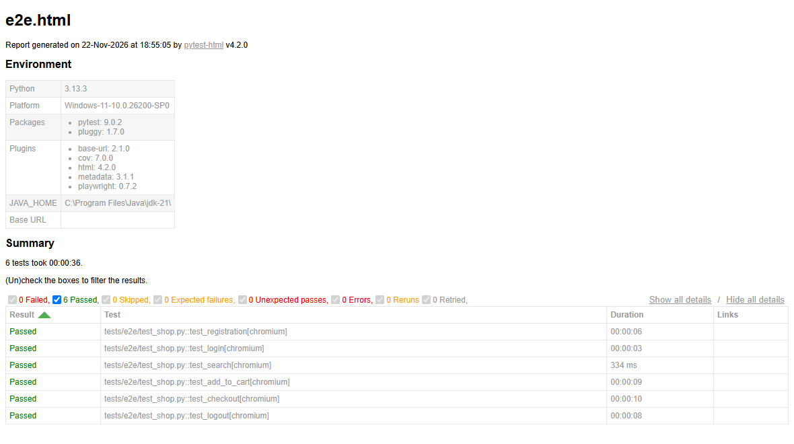
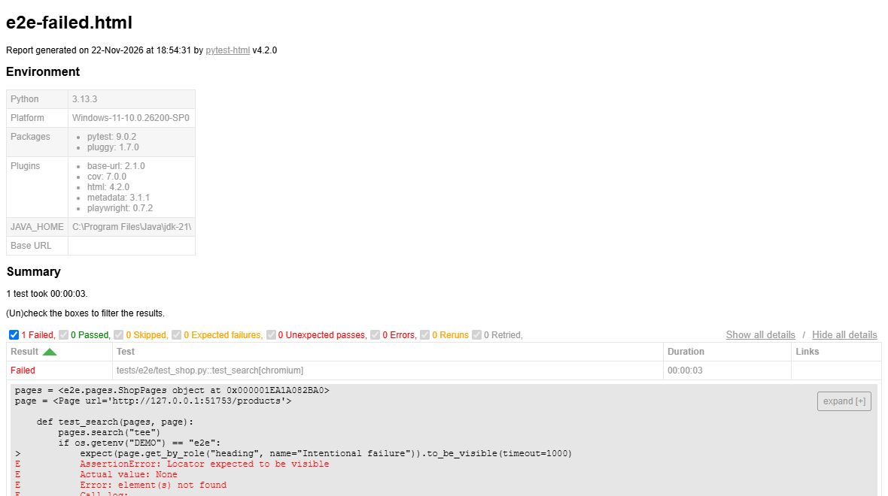

<div align="center">

**МИНИСТЕРСТВО НАУКИ И ВЫСШЕГО ОБРАЗОВАНИЯ РОССИЙСКОЙ ФЕДЕРАЦИИ**

*ФЕДЕРАЛЬНОЕ ГОСУДАРСТВЕННОЕ БЮДЖЕТНОЕ ОБРАЗОВАТЕЛЬНОЕ УЧРЕЖДЕНИЕ ВЫСШЕГО ОБРАЗОВАНИЯ*

*«БЕЛГОРОДСКИЙ ГОСУДАРСТВЕННЫЙ ТЕХНОЛОГИЧЕСКИЙ УНИВЕРСИТЕТ им. В. Г. ШУХОВА» (БГТУ им. В. Г. Шухова)*

Кафедра программного обеспечения вычислительной техники и автоматизированных систем

# Лабораторная работа № 4

**Тема** - Автоматизация UI-тестов и построение CI/CD-пайплайна с блокирующими quality gates

</div>

<div align="right">

Выполнила - Фатеева Марина Игоревна, группа ПВ-233<br>
Проверил - Доденко Олег Павлович

</div>

<div align="center">

*Белгород, 2026*

</div>

---

## Цель работы

Освоить автоматизацию браузерных тестов и настроить проверки, блокирующие сборку и выпуск при ошибках.

## 1. UI-автоматизация

Использован React-интерфейс edgistify-Assignment. Добавлены поиск и локальный Flask API с тестовым каталогом. Сценарии выполняются в Chromium через Playwright и взаимодействуют с API по HTTP.

Класс `ShopPages` в `tests/e2e/pages.py` хранит локаторы и действия. В `tests/e2e/test_shop.py` описаны проверки результатов. Каждый сценарий получает отдельный браузерный контекст, а сценарии с авторизацией используют отдельные учётные записи.

| Сценарий | Ожидаемый результат |
|---|---|
| Регистрация | Открывается форма входа, созданная учётная запись позволяет войти |
| Вход | Открывается каталог, доступна кнопка Logout |
| Поиск | Запрос tee оставляет Classic Tee и скрывает Canvas Cap |
| Добавление в корзину | Classic Tee отображается в корзине |
| Оформление заказа | Показано подтверждение с заказанным товаром |
| Выход | После выхода переход в корзину перенаправляет на вход |

Штатный прогон Playwright: 6 сценариев пройдены. В демонстрационном прогоне проверка поиска намеренно ожидает отсутствующий заголовок и завершается ошибкой.





## 2. Пирамида тестирования

```text
              / E2E: 6  \
             / API: 8    \
            / Unit: 12    \
           ----------------
```

| Уровень | Количество | Назначение |
|---|---:|---|
| Unit | 12 | Быстрые проверки вариантов поиска, валидации и расчёта суммы |
| Integration | 8 | Проверка HTTP-контрактов регистрации и входа, каталога, корзины и заказа |
| E2E | 6 | По одному браузерному сценарию на каждую ключевую операцию |

Варианты входных данных проверяются на уровне unit, правила авторизации и изоляция корзин - через API. В браузере оставлено по одному сценарию на каждую обязательную операцию.

## 3. CI/CD и quality gates

GitHub Actions запускает workflow на каждый `push` и `pull_request`. Сначала выполняются Ruff, unit-тесты, контроль покрытия и Bandit. Затем собирается React-приложение, запускаются интеграционные и браузерные тесты. Job `required-quality` требует успешного завершения всех пяти стадий. Релизный архив публикуется только после успешного push в `main`.

| Проверка | Блокирующее условие | Что останавливается |
|---|---|---|
| Unit и lint | Тест или Ruff завершился с ошибкой | Сборка и последующие стадии |
| Coverage | Покрытие ниже 80 % | Сборка при проверке бизнес-логики, E2E и релиз при проверке всего API после сборки |
| Bandit | Обнаружено замечание HIGH или сканирование завершилось ошибкой | Сборка и последующие стадии |
| Integration и E2E | Хотя бы один тест упал | Все следующие стадии |

Артефакты workflow содержат XML покрытия, JUnit XML для pytest, HTML-отчёт браузерных проверок, трассировки и скриншоты при падении, JSON Bandit. Шаблон badge размещён в `README.md`.

### 3.1. Локальная проверка

| Прогон | Результат |
|---|---|
| Штатные unit и integration | 20 тестов пройдены. Покрытие бизнес-логики 100 %, backend 93,68 % |
| Штатный Bandit | 0 находок HIGH |
| Намеренное падение unit | 1 тест упал, код завершения 1 |
| Сниженное покрытие | 66,67 % при пороге 80 %, код завершения 1 |
| Синтетический отчёт Bandit | 1 находка HIGH, код завершения 1 |

### 3.2. Подтверждение в GitHub Actions

Для запуска демонстраций предусмотрен параметр `demo`. Значение `unit` запускает намеренно падающий тест, `coverage` запускает только расчёт суммы, `security` подаёт синтетический отчёт с находкой HIGH через тот же фильтр, который применяется к отчёту Bandit. Значение `e2e` демонстрирует падение браузерной проверки. Обычные push и pull request запускают штатные проверки.

После публикации требуется включить защиту `main` и назначить обязательным статус `required-quality`. Скриншоты облачных прогонов и действующий badge появятся после публикации в GitHub.

## 4. Контрольные вопросы

1. **Пирамида тестирования** распределяет проверки по уровням. Много быстрых unit-тестов дают раннюю обратную связь. Интеграционные и браузерные сценарии проверяют связи компонентов и работу приложения для пользователя.
2. **Паттерны UI-тестирования** включают Page Object для локаторов и действий, Component Object для повторяющихся виджетов и Screenplay для описания сценариев через роли и действия.
3. **Quality gate** - обязательная проверка перед следующей стадией CI/CD. При невыполнении условия merge или выпуск блокируется.
4. **Порядок запуска.** Unit-тесты быстры и проверяют изменения при каждом push. Интеграционные тесты проверяют совместную работу компонентов после успешной сборки. E2E запускаются перед выпуском, поскольку проверяют весь путь пользователя и требуют браузера.

## Заключение

Автоматические проверки выявляют ошибки до слияния изменений. Зависимости заданий в CI останавливают сборку и выпуск при нарушении порогов или падении тестов.

## Команды для запуска и скриншотов

В PowerShell из папки проекта:

```powershell
Set-Location -LiteralPath 'D:\Четвертый курс\Тестирование\TestingPS\lab3'
python -m venv .venv
$py = '.\.venv\Scripts\python.exe'
& $py -m pip install -r requirements.txt
npm.cmd --prefix frontend ci
npm.cmd --prefix frontend run build
& $py -m playwright install chromium
```

Успешные проверки:

```powershell
& $py -m pytest tests/test_unit.py --cov=shop.domain --cov-fail-under=80
& $py -m pytest tests/test_integration.py
& $py -m pytest tests/e2e -q --html=artifacts/e2e.html --self-contained-html
```

Браузер можно открыть вручную через `& $py -m shop` по адресу `http://127.0.0.1:5000`. Для E2E сервер запускается автоматически. Чтобы видеть действия теста, добавьте `--headed`.

Для локального скриншота падения:

```powershell
$env:DEMO = 'e2e'
& $py -m pytest tests/e2e -k test_search --html=artifacts/e2e-failed.html --self-contained-html --screenshot=only-on-failure --tracing=retain-on-failure --output=artifacts/playwright
Remove-Item Env:DEMO
& $py -m http.server 8001 --bind 127.0.0.1 --directory artifacts
```

Откройте в браузере http://127.0.0.1:8001/e2e.html для успешного прогона и http://127.0.0.1:8001/e2e-failed.html для демонстрации падения. Сервер отчётов останавливается сочетанием Ctrl+C.

Локальное воспроизведение остальных блокировок:

```powershell
& $py -m pytest tests/fixtures/demo_unit_failure.py -q
& $py -m pytest tests/test_unit.py -k test_total --cov=shop.domain --cov-fail-under=80
& $py tools/security_gate.py --fixture tests/fixtures/bandit-high.json --report artifacts/bandit-demo.json
```

Создайте пустой репозиторий GitHub. Папка lab3 используется как корень репозитория, чтобы Actions находил .github/workflows/ci.yml. Перед первым коммитом замените OWNER/REPOSITORY в README. В PowerShell выполните, подставив адрес репозитория:

```powershell
git init -b main
git add .
git commit -m "Add shop UI tests and CI quality gates"
git remote add origin https://github.com/OWNER/REPOSITORY.git
git push -u origin main
git switch -c ci-demo
git push -u origin ci-demo
```

После успешного запуска в GitHub откройте **Settings → Branches → Add branch protection rule**. Укажите `main`, включите обязательный pull request, обязательные status checks и выберите `required-quality` после первого штатного прогона.

Для скриншотов используйте **Actions → Shop CI → Run workflow** на отдельной ветке. Сохраните снимки успешного штатного прогона и демонстраций:

| Значение `demo` | Что снять |
|---|---|
| `unit` | Красный job unit и серый job build со статусом skipped |
| `coverage` | Лог с покрытием ниже 80 % и пропущенный build |
| `security` | Лог с находкой HIGH и пропущенный build |
| `e2e` | Падение браузерного теста и красный required-quality |

